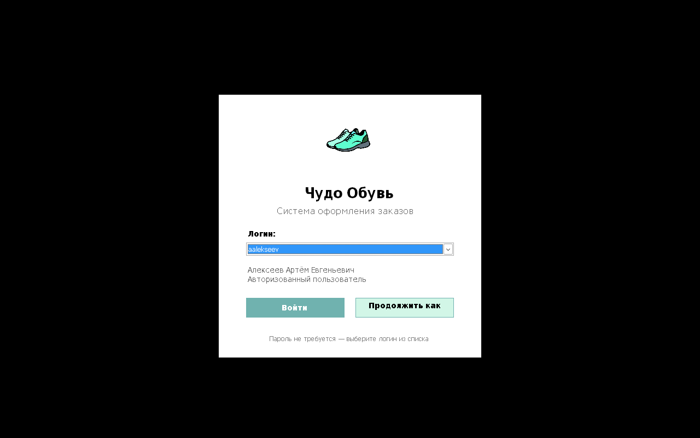
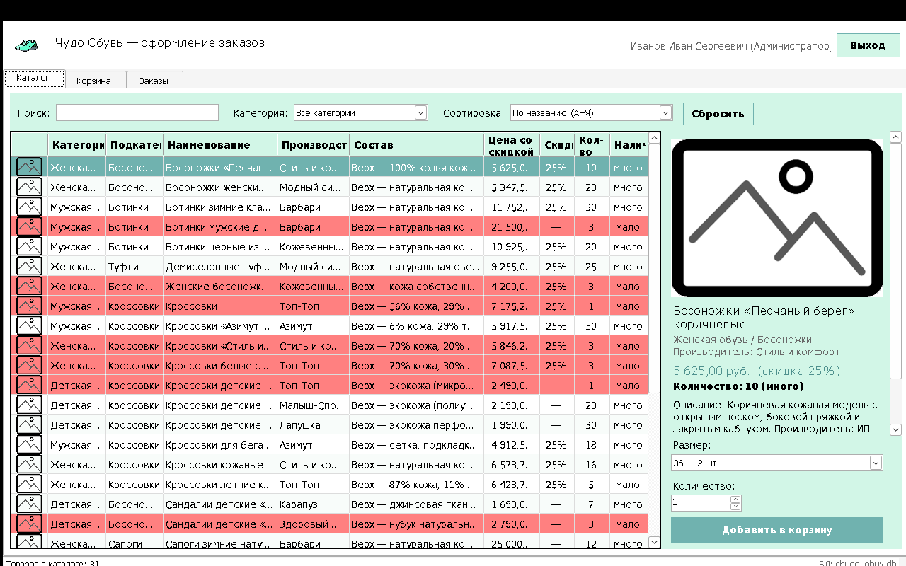
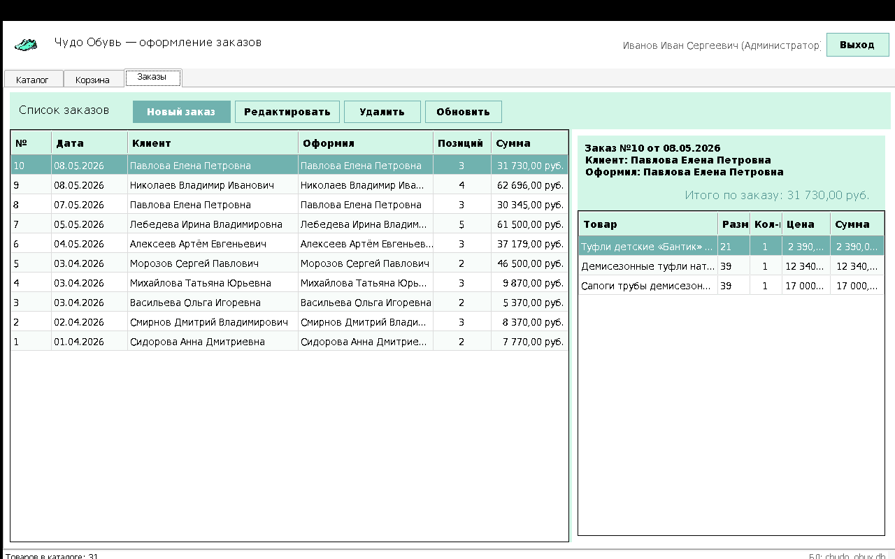
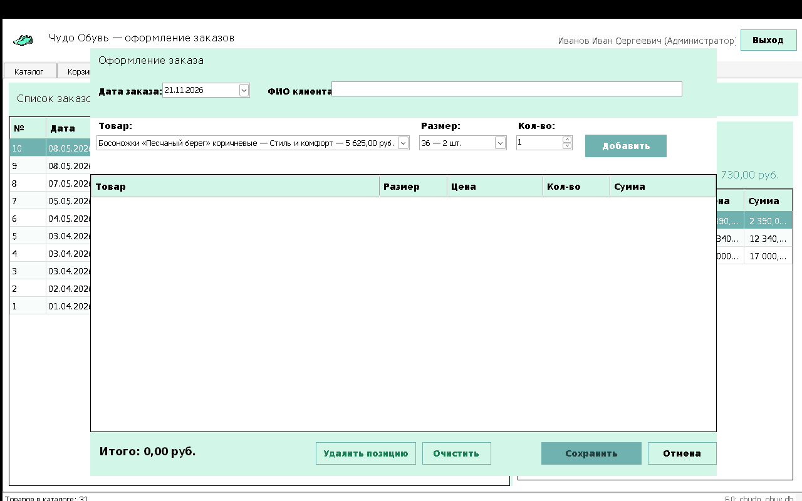

# Чудо Обувь — система оформления заказов

Готовое решение задания демонстрационного экзамена по специальности 09.02.07
(вариант «Чудо Обувь», 2027): база данных, каталог, авторизация по логину,
корзина и управление заказами.

Приложение написано на **C# WinForms (.NET 8)**. Интерфейс собран только из
стандартных элементов WinForms, без сторонних библиотек и без сложного дизайна.
База данных — **SQLite** (SQL-вариант, разрешённый в задании вместо MS Access).

---

## Быстрый запуск

### Вариант 1. Готовый exe (Windows x64)

Откройте папку `publish/win-x64` и запустите **`ChudoObuv.exe`**.

> На GitHub готовый архив лежит в разделе
> [Releases → v1.0](https://github.com/wthxtzy/demo-exam-MDK/releases/tag/v1.0):
> скачайте `ChudoObuv_win-x64.zip`, распакуйте и запустите `ChudoObuv.exe`.
>
> В локальном архиве `dist/ChudoObuv_win-x64.zip` эта же сборка лежит в корне
> папки `ChudoObuv`.

Это self-contained сборка: .NET 8 и SQLite уже внутри, устанавливать ничего не
нужно. Рядом с exe должны лежать:

- `chudo_obuv.db` — готовая база с данными;
- папка `Images` — логотип и картинка-заглушка.

Если файл базы удалить, приложение создаст его заново из встроенных скриптов
`schema.sql` и `seed.sql`.

### Вариант 2. Из исходников

Нужны Windows, Visual Studio 2022 (или .NET 8 SDK) и интернет для первого
восстановления NuGet-пакетов.

```powershell
dotnet build ChudoObuv.sln
dotnet run --project src/ChudoObuv.WinForms
```

Либо откройте `ChudoObuv.sln` в Visual Studio и запустите проект
`ChudoObuv.WinForms`.

### Тесты бизнес-логики

```powershell
dotnet run --project tests/ChudoObuv.Tests
```

Тестовый проект создаёт временную SQLite-базу, проверяет каталог, скидки,
остатки, создание/редактирование/удаление заказов и целостность данных.
Сейчас проходят **55 проверок**.

---

## Логины для входа

Пароль не требуется — по заданию вход выполняется только по логину из списка
пользователей.

| Роль | Логины |
|---|---|
| Администратор | `isivanov`, `apopov`, `afedorov`, `rkozlov` |
| Менеджер | `papetrov`, `ekuznetsova`, `psokolov`, `nnovikova`, `jvolkova`, `negorov`, `vstepanova` |
| Авторизованный пользователь | `asidorova`, `dsmirnov`, `ovasileva`, `tmikhailova`, `smorozov`, `aalekseev`, `ilebedeva`, `epavlova`, `vnikolaev` |
| Гость | кнопка «Продолжить как гость» |

Для проверки полного функционала удобнее всего войти как **`isivanov`**
(администратор).

---

## Что реализовано

### Задание 1. База данных

- Схема в **третьей нормальной форме**, с первичными и внешними ключами,
  ограничениями `FOREIGN KEY`, `CHECK`, `UNIQUE`.
- 8 таблиц: `Roles`, `Users`, `Categories`, `Subcategories`, `Products`,
  `ProductSizes`, `Orders`, `OrderItems`.
- ER-диаграмма: [`docs/ER_diagram.pdf`](docs/ER_diagram.pdf).
- Импорт данных из `Products_import.xlsx`, `Orders_import.xlsx`,
  `Users_import.xlsx`:
  - 31 модель товара;
  - 128 товарных позиций «модель + размер»;
  - 20 пользователей;
  - 10 заказов и 30 позиций заказов.
- Скрипты:
  - [`database/schema.sql`](database/schema.sql) — только структура;
  - [`database/seed.sql`](database/seed.sql) — только данные;
  - [`database/chudo_obuv.sql`](database/chudo_obuv.sql) — структура + данные;
  - [`database/chudo_obuv.db`](database/chudo_obuv.db) — готовая SQLite-база.

**Почему SQLite, а не Access.** В среде выполнения не было MS Access, поэтому
использован разрешённый в задании SQL-вариант. Скрипт `chudo_obuv.sql`
переносим в любую SQL-СУБД; для Access структуру и данные можно импортировать
через SQLite ODBC/экспорт, либо повторить таблицы в конструкторе Access
(имена и связи полностью описаны в ER-диаграмме).

### Задание 2. Каталог

- Вывод каталога из БД: изображение, категория, подкатегория, наименование,
  производство, состав, цена со скидкой, количество и признак «много/мало».
- Если файла изображения нет, выводится `Images/placeholder.png` (картинка-
  заглушка `picture.png` из ресурсов). Файлов товаров в комплекте нет, поэтому
  для всех моделей сейчас показывается заглушка.
- Скидка **25 %** на товары, которые не заказывали в апреле текущего года.
  Расчёт выполняется динамически по датам заказов.
- Товары с доступным количеством **≤ 3** подсвечиваются светло-красным
  (`#FF8080`).
- «много» — если суммарный остаток больше 5, иначе «мало».
- Для авторизованных пользователей доступны поиск, фильтр по категории и
  сортировка по названию, цене и количеству.

### Задание 3. Оформление заказа

- Вход по логину, без пароля; роль определяется по пользователю.
- Гость видит только каталог.
- Авторизованный пользователь:
  - просматривает каталог с поиском/фильтром/сортировкой;
  - выбирает размер и количество;
  - добавляет товары в корзину, удаляет позиции, очищает корзину;
  - оформляет заказ, указывает ФИО клиента;
  - видит свои заказы и их состав.
- Менеджер:
  - видит все заказы и их состав;
  - создаёт новые заказы;
  - удаляет заказы.
- Администратор:
  - всё, что доступно менеджеру;
  - редактирует существующие заказы.
- При создании заказа проверяется остаток по выбранному размеру, остаток
  списывается в транзакции.
- При удалении заказа товары возвращаются в наличие.
- При редактировании заказа старые позиции возвращаются на склад, новые
  проверяются и списываются; цены уже существующих позиций сохраняются.
- Все операции с заказом и остатками выполняются в одной транзакции SQLite.
- Список заказов показывает дату, ФИО клиента, автора, число позиций и сумму.

---

## Скриншоты

Вход:



Каталог, карточка товара и корзина:



Список заказов и состав заказа:



Форма заказа:



---

## Структура проекта

```
ChudoObuv/
├── ChudoObuv.sln
├── README.md
├── src/
│   ├── ChudoObuv.Core/          — БД, модели, авторизация, каталог, заказы
│   └── ChudoObuv.WinForms/      — формы WinForms
├── tests/
│   └── ChudoObuv.Tests/         — консольные интеграционные тесты
├── database/
│   ├── schema.sql
│   ├── seed.sql
│   ├── chudo_obuv.sql
│   └── chudo_obuv.db
├── docs/
│   ├── ER_diagram.pdf
│   ├── ER_diagram.dot
│   └── screenshots/
└── publish/
    └── win-x64/                 — готовый self-contained exe
```

Основные классы:

- `Database` — подключение, создание БД, выполнение встроенных скриптов;
- `AuthService` — список логинов и авторизация;
- `CatalogService` — каталог, остатки, скидки, поиск/фильтр/сортировка;
- `OrderService` — заказы, транзакции, склад;
- `Permissions` — права по ролям;
- `MainForm`, `LoginForm`, `OrderEditForm` — интерфейс.

---

## Схема данных

```
Roles 1 ─── N Users 1 ─── N Orders 1 ─── N OrderItems N ─── 1 ProductSizes
                                                               │
Categories 1 ─── N Subcategories 1 ─── N Products 1 ─── N ProductSizes
```

- `Products` хранит модель, производителя, описание, состав, цену и имя файла
  изображения.
- `ProductSizes` — товарные позиции «модель + размер» с остатком.
- `Orders` — дата, ФИО клиента и автор заказа.
- `OrderItems` — количество, цена на момент продажи и процент скидки.
- Справочники `Roles`, `Categories`, `Subcategories` вынесены отдельно,
  что обеспечивает 3НФ.

### Особенности импорта

В исходном `Products_import.xlsx` на модель дано **одно общее количество**, а не
количество по каждому размеру. Чтобы получить товарные позиции «модель + размер»
и сохранить общий остаток, общее количество распределено по доступным размерам
поровну, остаток — на первые размеры. Суммарный остаток модели при этом точно
совпадает с исходным числом (проверено тестами).

Исторические заказы из `Orders_import.xlsx` загружены как записи о продажах;
остатки в каталоге считаются текущими. При удалении заказа его товары
возвращаются в наличие.

---

## Оформление и стиль

- Шрифт Calibri.
- Основной фон белый, дополнительный `#D2F6E7`, акцент `#70B2AF`.
- Логотип выводится на форме входа и в шапке главного окна.
- Иконка приложения встроена в exe (`app.ico`).
- Использованы только базовые элементы: `Form`, `Panel`, `Label`, `TextBox`,
  `ComboBox`, `Button`, `DataGridView`, `PictureBox`, `NumericUpDown`,
  `DateTimePicker`, `TabControl`, `SplitContainer`, `FlowLayoutPanel`,
  `StatusStrip`.

Дизайн намеренно простой: приоритет — работоспособность и соответствие
функциональным требованиям.

---

## Проверка

```text
ВСЕ ТЕСТЫ ПРОЙДЕНЫ (55 проверок).
```

Проверяются:

- 20 пользователей и роли;
- права гостя, пользователя, менеджера, администратора;
- 31 модель, 128 позиций, 3 категории;
- скидки 0 % / 25 % по апрельским заказам;
- «много/мало» и подсветка остатка ≤ 3;
- поиск по кириллице без учёта регистра, фильтр и сортировка;
- создание заказа, списание остатка, запрет продажи при нехватке;
- удаление заказа и возврат остатка;
- редактирование заказа с возвратом старых позиций;
- суммы импортированных и новых заказов;
- отсутствие нарушений внешних ключей.

---

## Примечания

- Готовый exe рассчитан на **Windows x64**. Для другой разрядности соберите
  проект из исходников.
- База по умолчанию лежит рядом с exe. Если папка недоступна для записи,
  приложение использует `%LOCALAPPDATA%\ChudoObuv\chudo_obuv.db`.
- Файлы изображений товаров в исходном комплекте отсутствуют, поэтому
  используется предусмотренная заданием заглушка.
- Год для скидки берётся текущий (`DateTime.Today.Year`). На момент подготовки
  решения это 2026 год, поэтому апрельские заказы 2026 года корректно
  отменяют скидку у соответствующих товаров.
